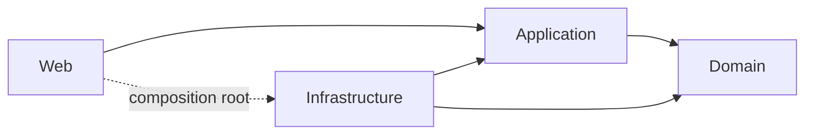

# DotNetPerformanceComparator

**Análisis de Rendimiento y Consumo de Recursos Computacionales Entre .NET 8 y .NET 10**

Herramienta web académica (Proyecto de Graduación) que permite tomar una aplicación ASP.NET Core en **.NET 8**, crear una **migración experimental independiente a .NET 10** y ejecutar sobre ambas versiones pruebas de rendimiento equivalentes para recopilar métricas de rendimiento y de consumo de recursos.

El flujo de trabajo cubre: incorporar la aplicación .NET 8 → migrarla experimentalmente a .NET 10 (sin modificar el original) → configurar una evaluación controlada → ejecutar la prueba sobre las dos versiones en condiciones equivalentes → recopilar y persistir las métricas. La **consulta, comparación, visualización final y generación de reportes PDF (CU-05 a CU-09) todavía están en desarrollo**.

## Objetivo

Facilitar una comparación **objetiva** entre una misma aplicación web ejecutada bajo .NET 8 y su migración experimental a .NET 10, manteniendo condiciones de prueba equivalentes (mismo endpoint, mismos parámetros, publicación en Release, orden de versiones alternado).

> La herramienta mide y registra datos; **no** declara que una versión sea universalmente mejor. Los valores obtenidos durante el desarrollo son evidencia experimental, no conclusiones científicas.

## Estado actual

| Caso de uso | Estado |
|-------------|--------|
| CU-01 — Incorporar aplicación .NET 8 | ✅ Completo |
| CU-02 — Migrar experimentalmente a .NET 10 | ✅ Completo |
| CU-03 — Configurar evaluación | ✅ Completo |
| CU-04 — Ejecutar prueba de rendimiento | ✅ Completo |
| CU-05 — Consultar resultados | ⏳ Pendiente |
| CU-06 — Filtrar resultados por métrica | ⏳ Pendiente |
| CU-07 — Comparar resultados .NET 8 / .NET 10 | ⏳ Pendiente |
| CU-08 — Visualizar resultados | ⏳ Pendiente |
| CU-09 — Generar reporte en PDF | ⏳ Pendiente |

**Hito actual:** ejecución experimental completa (Carga, Estrés y Concurrencia con las seis métricas, cancelación y reconexión).
**Pruebas:** 301/301 correctas · **Migraciones EF Core:** 6 · **Build:** 0 errores / 0 advertencias.

## Funcionalidades actuales

- Incorporación de un proyecto ASP.NET Core **.NET 8** indicando la ruta del `.csproj` y **validación** por inspección.
- **Migración experimental** independiente a **.NET 10** sobre una **copia** (el proyecto original permanece intacto).
- Configuración de evaluación: **un** tipo de prueba por configuración, **1 a 3** ejecuciones, **endpoint GET relativo** y selección de métricas.
- Tipos de prueba: **Carga**, **Estrés** (escalonado) y **Concurrencia** (por rondas sincronizadas).
- Ejecución **secuencial** de .NET 8 y .NET 10 con **orden alternado** por repetición, cada `Ejecucion` en un proceso nuevo.
- Preparación en **workspace temporal**: `dotnet publish -c Release` framework-dependent, entorno **Production**, SDK explícito por *major*.
- Monitoreo en vivo: progreso por fase/versión/repetición, **CPU/RAM en vivo** y **gráfico de evolución de CPU** (SVG propio).
- **Cancelación server-side** ("Detener evaluación") responsiva e independiente del circuito Blazor; **reconexión/F5** sin reiniciar ni cancelar la evaluación.
- **Persistencia** de ejecuciones, condiciones, resultados por métrica y niveles de estrés (EF Core + SQLite).

> Aún **no** implementadas: consulta histórica general, filtros por métrica, comparación final, pantallas M-06/M-07 y reportes PDF.

## Tipos de prueba

### Carga
Protocolo: **readiness** (GET hasta respuesta correcta) → **warm-up** → **ramp-up** → **ventana estable `KeepConstant`**. Las métricas oficiales corresponden **solo** a la ventana estable; warm-up y ramp-up se descartan.

### Estrés
**Warm-up único** seguido de **niveles escalonados** (`KeepConstant`), cada uno con una cantidad distinta de usuarios (de los iniciales a los máximos, por incrementos). Los resultados se **persisten por nivel**. Se distingue entre **saturación** (comportamiento observado de la app: 0 solicitudes exitosas o el proceso termina durante el nivel) y **fallo técnico** del evaluador.

### Concurrencia
Los N usuarios se **preparan en una barrera** y se **liberan de forma coordinada**; cada participante realiza **una solicitud por ronda**, con un intervalo entre rondas antes de la siguiente. No es simultaneidad física perfecta: se mide además el **StartSkew** (desfase de inicio) como **diagnóstico** de la sincronización, no como métrica oficial.

## Métricas

| Métrica | Definición operacional | Unidad |
|---------|------------------------|--------|
| CPU | Utilización promedio del proceso objetivo durante la ventana medida | % |
| Memoria RAM | Promedio de `Process.WorkingSet64` del proceso objetivo | MB |
| Tiempo de respuesta | **Mean** de latencia de las solicitudes HTTP exitosas del Step `request` | ms |
| Latencia | **P95** de latencia de las solicitudes HTTP exitosas del Step `request` | ms |
| Throughput | Solicitudes exitosas por segundo (RPS) reportadas por NBomber | req/s |
| Tamaño de la aplicación | Suma de todos los archivos del output de `dotnet publish -c Release` (framework-dependent) | MB |

> No existe una métrica de errores. `OK`/`Fallidas` se registran como **condiciones de ejecución** (diagnóstico), no como métrica.

## Arquitectura

Arquitectura limpia en cuatro capas:



- **Domain** — entidades y reglas; no depende de ninguna otra capa ni de infraestructura.
- **Application** — orquestación de casos de uso; define **abstracciones** (interfaces) y modelos; depende solo de Domain.
- **Infrastructure** — implementa esas abstracciones: filesystem, procesos, SDK/`dotnet`, SQLite (EF Core), motor de carga (NBomber), muestreo de recursos.
- **Web** — presentación Blazor Server; consume servicios de Application y referencia a Infrastructure **solo** como *composition root* en `Program.cs`.

Registro de servicios: `services.AddApplication()` y `services.AddInfrastructure(connectionString)`, invocados desde `src/DotNetPerformanceComparator.Web/Program.cs`. Las pruebas de arquitectura en `tests/` verifican estas dependencias.

## Estructura del repositorio

```
DotNetPerformanceComparator.sln
global.json                         SDK fijado a .NET 8 (8.0.425, rollForward latestFeature)
.config/dotnet-tools.json           Herramienta local dotnet-ef 8.0.31
src/
  DotNetPerformanceComparator.Domain          Entidades y constantes de dominio
  DotNetPerformanceComparator.Application      Casos de uso, abstracciones y modelos
  DotNetPerformanceComparator.Infrastructure   EF Core/SQLite, procesos, NBomber, ejecución
  DotNetPerformanceComparator.Web              Blazor Server (páginas M-01…M-05) + composición
tests/
  DotNetPerformanceComparator.Tests            Pruebas xUnit
docs/
  PROJECT_CONTEXT.md                 Fuente de verdad técnica/funcional
  UI_SPEC.md                         Decisiones e implementación de interfaces
  mockups/                           Referencias visuales (M-01…M-08)
```

## Tecnologías

Auditado contra los `*.csproj` actuales:

- **C# / .NET 8** (`net8.0`) — todos los proyectos.
- **ASP.NET Core / Blazor Server** (Interactive Server) — capa Web.
- **Entity Framework Core 8.0.31** (`Microsoft.EntityFrameworkCore.Sqlite` y `.Design`) + **SQLite**.
- **NBomber 6.6.0** — motor de generación de carga HTTP (aislado en Infrastructure).
- **xUnit 2.9.3** — pruebas automatizadas.
- **.NET 10** — *target* de la **migración experimental** (seleccionado dinámicamente en el flujo aislado, no es el framework del repositorio).

> **QuestPDF**: **previsto para CU-09** (reportes PDF); todavía no está incorporado. El muestreo de CPU/RAM usa `System.Diagnostics.Process` (no se usan `dotnet-counters` ni `Microsoft.Diagnostics.NETCore.Client`).

## Requisitos

- La herramienta/host está fijada a **.NET 8** mediante `global.json` (`8.0.425`, `rollForward: latestFeature`): el repositorio se compila y ejecuta siempre con el SDK 8, aunque haya un SDK 10 instalado.
- **.NET 10 se selecciona explícitamente solo dentro del flujo experimental aislado** (CU-02/CU-04), en workspaces temporales; nunca se modifica el `global.json` del repositorio para ello.
- Para usar CU-02/CU-04 con ambas versiones, el equipo debe tener instalados un **SDK estable de .NET 8** y un **SDK estable de .NET 10** (cada uno incluye su runtime de ASP.NET Core correspondiente).
- **Windows 11** es el entorno principal soportado por el proyecto académico (selección nativa de archivos/carpetas y rutas absolutas locales).

## Puesta en marcha

```bash
dotnet tool restore
dotnet restore
dotnet build
dotnet test
```

La base de datos SQLite es local y **no** se versiona; el esquema vive en las migraciones EF Core. En una copia nueva, aplica las migraciones para crear la base antes de ejecutar:

```bash
dotnet ef database update --project src/DotNetPerformanceComparator.Infrastructure --startup-project src/DotNetPerformanceComparator.Web
```

Ejecutar la herramienta:

```bash
dotnet run --project src/DotNetPerformanceComparator.Web
```

> `Program.cs` no aplica migraciones automáticamente; por eso el paso `database update` es necesario en un entorno limpio. CU-02/CU-04 lanzan procesos `dotnet` reales para publicar y ejecutar las aplicaciones objetivo en un workspace temporal, que se elimina al terminar.

## Pruebas

**301 pruebas automatizadas correctas** (xUnit). A alto nivel cubren:

- Lógica de **Application** (configuración, construcción de resultados, planes de ejecución).
- **Persistencia** EF Core/SQLite (índices únicos, `DeleteBehavior.Restrict`, agregados).
- **Migración experimental** (copia segura, selección de SDK, ejecución de `dotnet`).
- **Motor de ejecución** y tipos de prueba: **Carga**, **Estrés** (niveles, saturación) y **Concurrencia** (barreras, rondas, StartSkew).
- **UI lógica/geometría** (sesión server-side, serie de CPU, geometría de los gráficos SVG).
- **Arquitectura** (dependencias entre capas).

```bash
dotnet test
```

## Seguridad y datos locales

- La base **SQLite** es local; `*.db` (y `*.db-shm` / `*.db-wal`) está en `.gitignore`.
- Los **proyectos .NET evaluados** residen fuera del repositorio y no se versionan automáticamente.
- Los **workspaces temporales** de ejecución se eliminan al terminar.
- No deben almacenarse **secretos ni rutas personales** en el repositorio.

## Documentación

- [docs/PROJECT_CONTEXT.md](docs/PROJECT_CONTEXT.md) — fuente de verdad técnica y funcional (casos de uso, arquitectura, modelo de datos, decisiones D-xx).
- [docs/UI_SPEC.md](docs/UI_SPEC.md) — decisiones e implementación de las interfaces (M-01…M-08, decisiones UI-xx, brechas B-xx).
- [docs/mockups/](docs/mockups/) — referencias visuales de las pantallas.

## Próximos pasos

- **CU-05** — Consultar resultados
- **CU-06** — Filtrar resultados por métrica
- **CU-07** — Comparar resultados entre .NET 8 y .NET 10
- **CU-08** — Visualizar resultados
- **CU-09** — Generar reporte en PDF

## Contexto académico

Proyecto de Graduación — Ingeniería en Sistemas
Universidad Mariano Gálvez de Guatemala — Campus Cobán
Autor: **ManuelMZ06**
